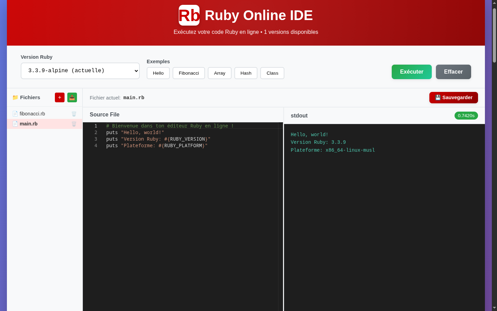

# playground_ruby

A small Ruby playground that runs on your own machine. You write code in a Monaco editor in the browser and pick a Ruby version, then an Express backend runs it in a new Docker or Podman container that is deleted right after. Files are saved in `backend/workspace/`. The UI is in French.



## Setup

You need Node 18 or newer and Docker, or Podman with its API socket. The editor is loaded from jsDelivr, so the browser needs internet.

```sh
npm run install-all
docker pull ruby:3.3.9-alpine   # or: podman pull docker.io/library/ruby:3.3.9-alpine
npm run dev
```

Then open http://localhost:3000 (the backend is on port 5000). The versions come from `version_langage/ruby_versions.txt`, but the UI only lists the images you have pulled. The alpine ones are about 70 MB, the plain `ruby:3.4.x` ones about 1 GB.

With rootless Podman the backend talks to the Docker-compatible socket:

```sh
systemctl --user enable --now podman.socket
export DOCKER_HOST=unix://$XDG_RUNTIME_DIR/podman/podman.sock
```

`npm test` runs the backend tests, they don't need Docker.

## Security

It runs whatever code it gets, so it's only meant for localhost. Both servers listen on 127.0.0.1 and the backend refuses any request whose `Host` header isn't localhost, to block DNS rebinding. There is no login and no rate limit, anyone on the machine can use it.

Each run is `ruby -e <code>` in a fresh container as user nobody, with no network, all capabilities dropped, a read-only root filesystem with a 16 MB `/tmp`, 256 MB of memory, half a CPU and 64 processes. It gets killed after 15 s or 64 KB of output, and only 2 runs can go at the same time. The containers still share the host kernel, so I wouldn't put this on the internet as it is.
